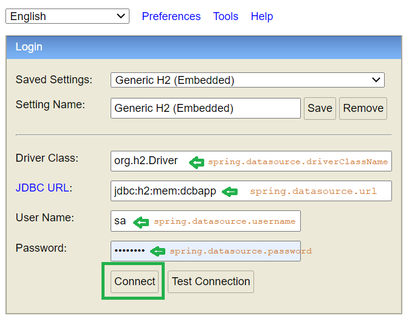

# Currency Converter

**Descrição**: Uma API RESTful para converter moedas usando taxas de câmbio em tempo real. Os utilizadores podem se autenticar e realizar conversões, armazenando um histórico das suas transações. 

## Tecnologias

- Java (Spring Boot)
- RESTful API Development 
- HTTP Client (RestTemplate/WebClient)
- JSON Parsing (Jackson)
- In-memory Database (H2)

### In-memory Database (H2)

In-memory Database (H2) é um banco de dados relacional leve, em memória, escrito em Java, muito usado com Spring Boot para desenvolvimento rápido e testes. Não precisa de configuração externa e permite execução rápida de operações de banco de dados.

- Suporta modos em memória e embutido para uso flexível
- Oferece alta performance com suporte a JDBC e gerenciamento de transações
- Inclui recursos como console baseado no navegador, criptografia e busca por texto completo

#### Acessando o H2 Console 
 
É possível acessar o console H2 no navegador chamando a URL **http://localhost:8080/h2-console**



## API

A documentação interativa está disponível em
**http://localhost:8080/swagger-ui.html**. O contrato OpenAPI pode ser acessado
em **http://localhost:8080/v3/api-docs**.

Crie um usuário sem autenticar:

```http
POST /users
Content-Type: application/json

{"username":"alice","password":"change-me"}
```

A resposta contém a `apiKey` gerada. Envie-a como `X-API-Key` para os
seguintes endpoints:

- `POST /api/conversions` com `{"from":"USD","to":"EUR","amount":100}`
- `GET /api/conversions` para consultar o histórico do utilizador autenticado
- `GET /api/rates?baseCode=USD` para consultar as taxas de uma moeda base
- `GET /api/currencies?baseCode=USD` para listar as moedas suportadas

As taxas são obtidas do endpoint público da ExchangeRate-API. Configure
`exchange-rates.url` em `application.properties` para utilizar outro
provedor compatível.